# Modelo relacional

Modelo objetivo. Ya están implementadas `SUBJECT` (4.1) y `ACADEMIC_PERIOD`, `COURSE`, `COURSE_ENROLLMENT` y `COURSE_TOPIC` (4.3); el estado real de cada una está en `docs/ENTIDADES.md`.

```mermaid
erDiagram
    %% PK: clave primaria | FK: clave foránea | UK: valor único
    %% Se omiten createdAt y updatedAt para mantener legible el diagrama;
    %% existen en todos los modelos, salvo en las tablas puente.

    USER {
        string id PK
        string email UK
        string firstName
        string lastName
        string documentId UK
        Role role
    }

    SESSION {
        string id PK
        string userId FK
        string token UK
        DateTime expiresAt
    }

    NOTIFICATION {
        string id PK
        string userId FK
        NotificationType type
        string title
        DateTime readAt
        DateTime emailSentAt
    }

    PUSH_SUBSCRIPTION {
        string id PK
        string userId FK
        string endpoint UK
    }

    SUBJECT {
        string id PK
        string code UK
        string name
        int credits
        string objective
        string specificObjectives
    }

    ACADEMIC_PERIOD {
        string id PK
        string name UK
        DateTime startDate
        DateTime endDate
    }

    COURSE {
        string id PK
        string subjectId FK
        string periodId FK
        string group
        CourseStatus status
        DateTime finalizedAt
        DateTime reactivatedAt
        DateTime exportedAt
        DateTime purgedAt
    }

    COURSE_TOPIC {
        string id PK
        string courseId FK
        string topicId FK
        boolean visible
        DateTime publishDate
    }

    COURSE_ENROLLMENT {
        string id PK
        string courseId FK
        string userId FK
        boolean active
        boolean isMonitor
        DateTime enrolledAt
        DateTime deactivatedAt
    }

    TOPIC {
        string id PK
        string subjectId FK
        string parentTopicId FK
        string name
        string slug
        int order
    }

    CONTENT {
        string id PK
        string topicId FK
        string name
        string body
        int order
    }

    CONTENT_RESOURCE {
        string id PK
        string contentId FK
        ResourceKind kind
        string title
        string url
        string filePath
        int order
    }

    MATERIAL_CATEGORY {
        string id PK
        string name UK
    }

    MATERIAL {
        string id PK
        string categoryId FK
        string name
        string author
        string url
        string filePath
    }

    MATERIAL_TOPIC {
        string materialId PK, FK
        string topicId PK, FK
    }

    COURSE_READING {
        string id PK
        string courseId FK, UK
        string materialId FK
    }

    CHAPTER {
        string id PK
        string materialId FK
        string name
        int startPage
        int endPage
        int order
    }

    CHAPTER_PROCESS {
        string id PK
        string chapterId FK
        string courseId FK
        int roundNumber
        ChapterProcessStatus status
        DateTime publishedAt
        DateTime openUntil
    }

    CHAPTER_CANDIDATE {
        string id PK
        string processId FK
        string studentId FK
        int position
        CandidateStatus status
        DateTime turnExpiresAt
        DateTime respondedAt
    }

    CHAPTER_ASSIGNMENT {
        string id PK
        string processId FK, UK
        string studentId FK
        DateTime acceptedAt
    }

    TASK {
        string id PK
        string subjectId FK
        string materialId FK
        string topicId FK
        string name
        string statement
    }

    TASK_OFFERING {
        string id PK
        string taskId FK
        string courseId FK
        DateTime publicationDate
        DateTime unlockAt
        DateTime dueAt
    }

    TASK_ATTACHMENT {
        string id PK
        string taskOfferingId FK
        ResourceKind kind
        string title
        string url
        string filePath
        int order
    }

    TASK_RANGE {
        string id PK
        string courseId FK
        string evaluationItemId FK
        string name
        DateTime startDate
        DateTime endDate
    }

    TASK_RANGE_TASK {
        string taskRangeId PK, FK
        string taskOfferingId PK, FK
    }

    EVALUATION_ITEM {
        string id PK
        string subjectId FK
        string name
    }

    EVALUATION_ASSIGNMENT {
        string id PK
        string courseId FK
        string evaluationItemId FK
        string studentId FK
        decimal percentage
        decimal grade
        GradeSource gradeSource
    }

    FINAL_GRADE {
        string id PK
        string courseId FK
        string studentId FK
        decimal calculated
        decimal override
        string overrideReason
        string overriddenById FK
    }

    BONUS_CONCEPT {
        string id PK
        string name UK
    }

    BONUS {
        string id PK
        string courseId FK
        string studentId FK
        string conceptId FK
        string createdById FK
        string description
        int points
        DateTime date
    }

    CLASS_SESSION {
        string id PK
        string courseId FK
        string topicId FK
        DateTime startsAt
        DateTime endsAt
    }

    CLASS_SESSION_CONTENT {
        string classSessionId PK, FK
        string contentId PK, FK
    }

    ATTENDANCE {
        string id PK
        string classSessionId FK
        string studentId FK
        boolean present
    }

    AUDIT_LOG {
        string id PK
        string actorId FK
        string action
        string entity
        string entityId
        json oldValues
        json newValues
        DateTime createdAt
    }

    USER ||--o{ SESSION : "tiene"
    USER ||--o{ NOTIFICATION : "recibe"
    USER ||--o{ PUSH_SUBSCRIPTION : "registra"
    USER ||--o{ COURSE_ENROLLMENT : "se matricula"
    USER ||--o{ CHAPTER_CANDIDATE : "es candidato"
    USER ||--o{ CHAPTER_ASSIGNMENT : "recibe lectura"
    USER ||--o{ EVALUATION_ASSIGNMENT : "recibe ítem"
    USER ||--o{ FINAL_GRADE : "obtiene nota"
    USER |o--o{ FINAL_GRADE : "sobrescribe"
    USER ||--o{ BONUS : "recibe bono"
    USER ||--o{ BONUS : "registra bono"
    USER ||--o{ ATTENDANCE : "asiste"
    USER |o--o{ AUDIT_LOG : "actúa"

    SUBJECT ||--o{ COURSE : "se ofrece"
    ACADEMIC_PERIOD ||--o{ COURSE : "contiene"
    COURSE ||--o{ COURSE_ENROLLMENT : "tiene"
    COURSE ||--o{ COURSE_TOPIC : "configura"
    TOPIC ||--o{ COURSE_TOPIC : "se publica"
    COURSE ||--o{ TASK_OFFERING : "habilita"
    COURSE ||--o{ TASK_RANGE : "agrupa"
    COURSE ||--o| COURSE_READING : "asigna"
    COURSE ||--o{ CHAPTER_PROCESS : "aplica"
    COURSE ||--o{ EVALUATION_ASSIGNMENT : "contiene"
    COURSE ||--o{ FINAL_GRADE : "calcula"
    COURSE ||--o{ BONUS : "otorga"
    COURSE ||--o{ CLASS_SESSION : "programa"

    SUBJECT ||--o{ TOPIC : "tiene"
    TOPIC ||--o{ TOPIC : "subtemas"
    TOPIC ||--o{ CONTENT : "contiene"
    CONTENT ||--o{ CONTENT_RESOURCE : "tiene"

    MATERIAL_CATEGORY ||--o{ MATERIAL : "clasifica"
    MATERIAL ||--o{ MATERIAL_TOPIC : "se asocia"
    TOPIC ||--o{ MATERIAL_TOPIC : "referencia"

    MATERIAL ||--o{ COURSE_READING : "se usa"
    MATERIAL ||--o{ CHAPTER : "contiene"
    CHAPTER ||--o{ CHAPTER_PROCESS : "procesa"
    CHAPTER_PROCESS ||--o{ CHAPTER_CANDIDATE : "candidatos"
    CHAPTER_PROCESS ||--o| CHAPTER_ASSIGNMENT : "asigna"

    SUBJECT ||--o{ TASK : "define"
    MATERIAL |o--o{ TASK : "enlaza"
    TOPIC |o--o{ TASK : "referencia"
    TASK ||--o{ TASK_OFFERING : "se habilita"
    TASK_OFFERING ||--o{ TASK_ATTACHMENT : "adjunta"

    TASK_RANGE ||--o{ TASK_RANGE_TASK : "incluye"
    TASK_OFFERING ||--o{ TASK_RANGE_TASK : "pertenece"
    EVALUATION_ITEM |o--o{ TASK_RANGE : "evalúa"

    SUBJECT ||--o{ EVALUATION_ITEM : "define"
    EVALUATION_ITEM ||--o{ EVALUATION_ASSIGNMENT : "aplica"

    BONUS_CONCEPT |o--o{ BONUS : "clasifica"

    TOPIC |o--o{ CLASS_SESSION : "trata"
    CLASS_SESSION ||--o{ CLASS_SESSION_CONTENT : "incluye"
    CONTENT ||--o{ CLASS_SESSION_CONTENT : "referenciado"
    CLASS_SESSION ||--o{ ATTENDANCE : "registra"
```

